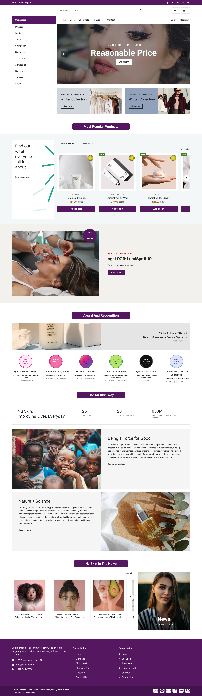
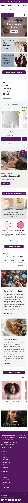
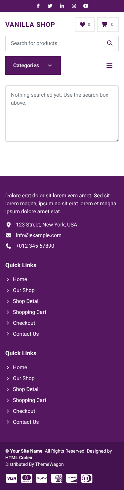

# vanilla-shop

[](https://github.com/hoquangsang/vanilla-shop/actions/workflows/deploy.yml)
[](https://github.com/hoquangsang/vanilla-shop/actions/workflows/lighthouse.yml)
[](https://vanilla-shop-gamma.vercel.app)

A responsive two-page shop (Home + Detail) built for the **XTech789 front-end intern test**. It uses Vite, TypeScript, Tailwind CSS v4 and a hand-written **MVC** layer, with no framework and no backend.

**Live:** https://vanilla-shop-gamma.vercel.app · [Detail page](https://vanilla-shop-gamma.vercel.app/detail.html?q=Reasonable+Price)

| Home, 1440px | Home, 375px | Detail, 375px |
|---|---|---|
|  |  |  |

More sizes are in [`docs/screenshots/`](docs/screenshots/). Run `pnpm screenshots` to regenerate them.

## What the brief asks for

| Requirement | Where | Tested by |
|---|---|---|
| ✅ Home page built from the design | [`index.html`](index.html), [`docs/design/`](docs/design/README.md) | `tests/e2e/home-*.spec.ts` |
| ✅ Responsive on every device | mobile-first Tailwind. No horizontal scroll from 320px to 1920px | `tests/e2e/quality.spec.ts` (8 widths × 2 pages) |
| ✅ "Add to cart" increments the cart icon on every click | `CartModel` → `CartController` → `CartBadgeView`. Kept in `localStorage`, shared by both pages | `tests/e2e/cart.spec.ts` |
| ✅ Detail page with the Home header/footer and a textarea | [`detail.html`](detail.html) + shared partials | `tests/e2e/search.spec.ts` |
| ✅ MVC: text typed in search is shown on Detail | `SearchModel` → `SearchController` / `DetailController` → `DetailView` ([diagram](docs/mvc.md)) | `tests/unit/**`, `tests/e2e/search.spec.ts` |

Extras:
- accessibility (axe has no serious violations; Lighthouse a11y score is 100);
- user text is never rendered as HTML;
- performance budgets are checked by Lighthouse CI;
- every PR gets a preview deploy.

## Architecture

```
index.html, detail.html     page shells; header/footer come from src/partials via a small Vite plugin
src/
  core/                     typed EventEmitter, safe localStorage, DOM helpers
  models/                   CartModel, SearchModel, ProductModel: state and rules, no DOM
  views/                    DOM only: render(...) + bind<Event>(handler); never import models
  controllers/              the only layer that knows both models and views
  pages/                    composition roots: create models, views and controllers, then wire them
  data/products.json        product catalogue
tests/unit/                 Vitest + happy-dom
tests/e2e/                  Playwright at 375 / 768 / 1440
```

The layering is enforced, not just documented: a [Claude Code hook](.claude/hooks/guard-mvc.mjs) rejects any edit where a view imports a model or a model touches the DOM. The data flow is in [`docs/mvc.md`](docs/mvc.md).

**Stack:** Vite (multi-page) · TypeScript strict · Tailwind CSS v4 · Swiper · Font Awesome (subset) · Roboto · Vitest · Playwright · axe-core · Lighthouse CI · ESLint + Prettier · pnpm · Node 24.

## Run it

```bash
pnpm install
pnpm dev            # http://localhost:5173
```

| Script | Does |
|---|---|
| `pnpm build` / `pnpm preview` | typecheck and production build to `dist/`, then serve it |
| `pnpm check` | lint, typecheck, unit tests and build: the gate every PR must pass |
| `pnpm test` / `pnpm test:e2e` | unit tests / Playwright e2e (builds and previews first) |
| `pnpm lhci` | Lighthouse CI with the budgets in `lighthouserc.json` |
| `pnpm screenshots` | regenerate `docs/screenshots/*.png` |

## CI/CD

```
PR ──► ci (lint · typecheck · unit · build · e2e) ──► Vercel preview + PR comment
   ├─► Claude review (CLAUDE.md + OpenSpec specs)
   └─► Lighthouse (budgets + PR comment)
main ──► ci ──► Vercel production
```

- **Workflows:** [`.github/workflows/`](.github/workflows/).
- **Branch rules:** `main` is protected. A PR and a green `ci / check` are required, history stays linear, and merges are squash-only.
- **Deploys:** Vercel's own Git deploys are off, so GitHub Actions is the only deployer.

## How this was built with Claude Code

The plan, specs and reviews were written by a local Claude Code session. The code was written by cloud Claude Code sessions, one [OpenSpec](https://github.com/Fission-AI/OpenSpec) change per PR, and checked by repo hooks, review agents and a Claude PR reviewer. A human made the key decisions and approved the plan.

The full write-up, covering roles, the spec flow, hooks, agents, skills, problems and lessons, is in **[`docs/AI_WORKFLOW.md`](docs/AI_WORKFLOW.md)**.

| Path | What |
|---|---|
| [`openspec/specs/`](openspec/specs/) | The system's current specs (requirements + scenarios) |
| [`openspec/changes/archive/`](openspec/changes/archive/) | Every change that built it: proposal, design, tasks |
| [`openspec/ROADMAP.md`](openspec/ROADMAP.md) | Order, status and shared contracts between changes |
| [`CLAUDE.md`](CLAUDE.md) | Rules for Claude Code sessions in this repo |
| [`.claude/`](.claude/) | Hooks, review agents (`responsive-reviewer`, `a11y-auditor`, `spec-verifier`) and skills |

## Credits

The design is from the test brief. The photos are free Unsplash images used as placeholders; see [`public/images/CREDITS.md`](public/images/CREDITS.md). The award seals are drawn by hand as SVGs.
