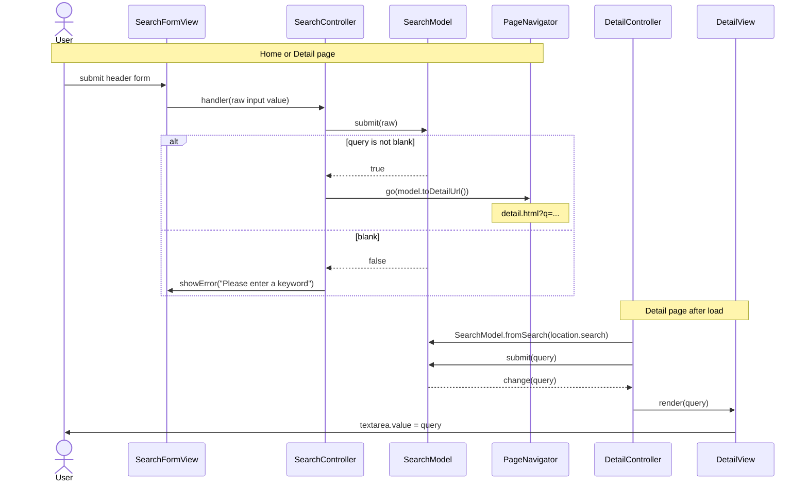

# MVC in vanilla-shop

The app has no framework. State lives in **models**, DOM work lives in **views**, and **controllers** are the only code that knows both.

- Models never touch the DOM and never import views or controllers.
- Views never import models. They expose `render(...)` and `bind<Event>(handler)`.
- Controllers subscribe to model events, call view renders, and pass view events to the model.
- `src/pages/*.ts` only instantiate and connect the three.

## Search → Detail flow

The URL is the hand-off between pages: model state on the first page becomes the URL, and the URL becomes model state on the Detail page. No storage is needed, links are shareable, and a reload shows the same text.

## File map

| File | Layer | Responsibility |
|---|---|---|
| `src/models/search-model.ts` | Model | Normalise and validate the query, hold it, build the Detail URL |
| `src/views/search-form-view.ts` | View | Header form: intercept submit, show or clear the empty-query hint |
| `src/views/detail-view.ts` | View | Put the query into the Detail textarea (`.value`, never `innerHTML`) |
| `src/controllers/search-controller.ts` | Controller | Form submit → model → navigate or show the hint |
| `src/controllers/detail-controller.ts` | Controller | URL query → model → `DetailView.render` |
| `src/core/navigation.ts` | Core | `PageNavigator`, injected so tests do not navigate |
| `src/pages/search.ts` | Wiring | `initSearch()` (both pages), `initDetail()` (Detail) |
| `src/models/cart-model.ts` | Model | Cart items and count, persisted through `core/storage.ts` |
| `src/views/cart-badge-view.ts` | View | Header badge number, accessible label, live announcement |
| `src/views/add-to-cart-view.ts` | View | "Add to cart" clicks and the temporary "Added ✓" label |
| `src/controllers/cart-controller.ts` | Controller | Button click → model; model change → badge |
| `src/pages/cart.ts` | Wiring | `initCart()` (both pages) |
